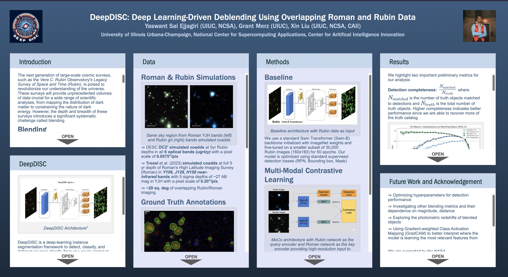

**DeepDISC: Deep Learning-Driven Deblending Using Overlapping Roman and Rubin LSST Data**

> **Abstract:** The Vera C. Rubin Observatory’s Legacy Survey of Space and Time (LSST) will revolutionize cosmology through remarkable statistical power, yet unrecognized blends in ground-based surveys introduce a major source of systematic errors. DeepDISC, our deep learning source detector/deblender/classifier, addresses this critical challenge by synergizing LSST data with high-resolution imaging from the Nancy Grace Roman Space Telescope (Roman). With Roman's capability to survey the sky 1000 times faster than Hubble, while maintaining similar sensitivity and resolution, it presents a unique opportunity to enhance our understanding of galaxy structures and distributions. By leveraging Roman's higher resolution space-based imaging in combination with LSST data, we aim to significantly improve the recognition of blended sources compared to traditional detection algorithms. Our model will be trained on simulated Rubin images and input catalogs as a baseline, with the addition of Roman imaging data during training and testing phases. This approach will allow us to quantify the impact of Roman's higher resolution on blend recognition, source classification accuracy, and overall catalog completeness and purity. By comparing DeepDISC's performance against truth catalogs and science pipeline results from both Roman and LSST, we will demonstrate how this synergy between space-based and ground-based observations can optimize scientific output and directly address systematic uncertainties that impact dark energy constraints from LSST, particularly through probes like weak lensing. Preliminary tests show a 10% improvement in detection completeness-achieved exclusively through joint Roman-LSST training-leading to a better mapping of the universe that will be crucial for downstream cosmological analyses. This work highlights a paradigm for Rubin-era discovery: integrating multi-survey data with machine learning driven analysis to overcome fundamental limits in ground-based observations.

The American Astronomical Society (AAS) held its [247th meeting](https://aas.org/meetings/aas247) on January 4–8, 2026, at the Phoenix Convention Center in Phoenix, AZ. The winter meeting, held jointly with the AAS Historical Astronomy Division, was in-person only.

At the meeting, I presented my work done as an undergraduate and postbacc with Prof. Xin Liu and Dr. Grant Merz at UIUC.
