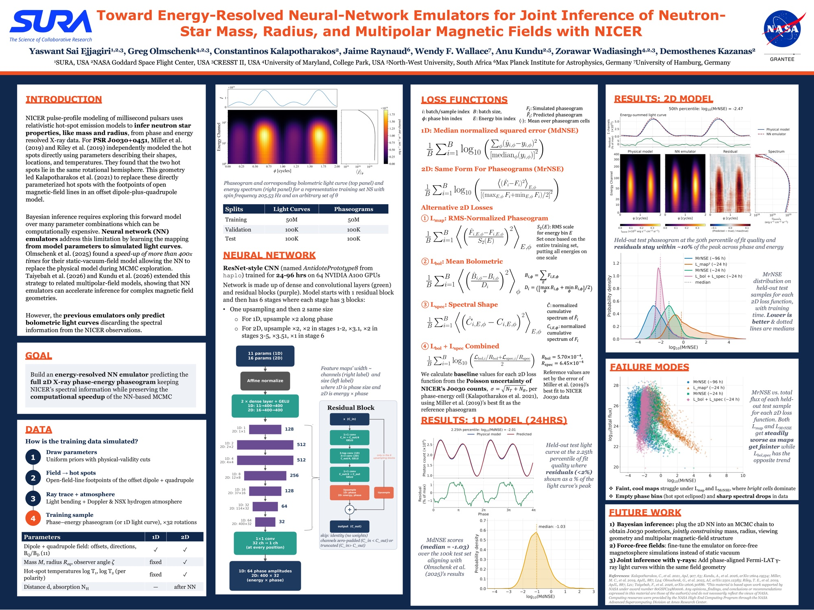

**Toward Energy-Resolved NN Emulators for Joint Inference of Neutron-Star Mass, Radius, and Multipolar Magnetic Fields with NICER**

> **Abstract:** Neural-network (NN) emulators can accelerate NICER pulse-profile inference of neutron-star mass and radius, but existing implementations have focused on bolometric light curves, discarding the spectral information available in the observations. We present progress toward extending this approach to the full phase- and energy-resolved thermal X-ray signal. After benchmarking NN architectures within the existing bolometric framework, we train networks on 50 million simulated phase-energy maps of PSR J0030+0451 generated with hydrogen-atmosphere emission and magnetically determined hotspot geometries. We find that training objectives effective for one-dimensional bolometric profiles do not transfer directly to the two-dimensional problem, motivating alternative loss functions and performance metrics that account for structure across both phase and energy. The resulting framework is being developed for integration with interstellar absorption, the NICER response, and Bayesian inference.

**Recorded Talk**



**Lightning Slide**


<video src="JSI_LT_Slide.mp4" autoplay loop muted playsinline width="100%"></video>


The Joint Space-Science Institute (JSI), a partnership between the University of Maryland and NASA's Goddard Space Flight Center, held the [2026 JSI Workshop: A NICER Legacy: Neutron Stars, Black Holes, and Time-Domain Astronomy](https://jsi.umd.edu/jsi-workshop-2026/) on November 2-4, 2026. The workshop was held at the Graduate Hotel, located in the Annapolis, MD. At this workshop, I presented my work done as a CRESST II Postbacc at NASA Goddard Space Flight Center with Dr. Constantinos Kalapotharakos and Dr. Gregory Olmschenk.