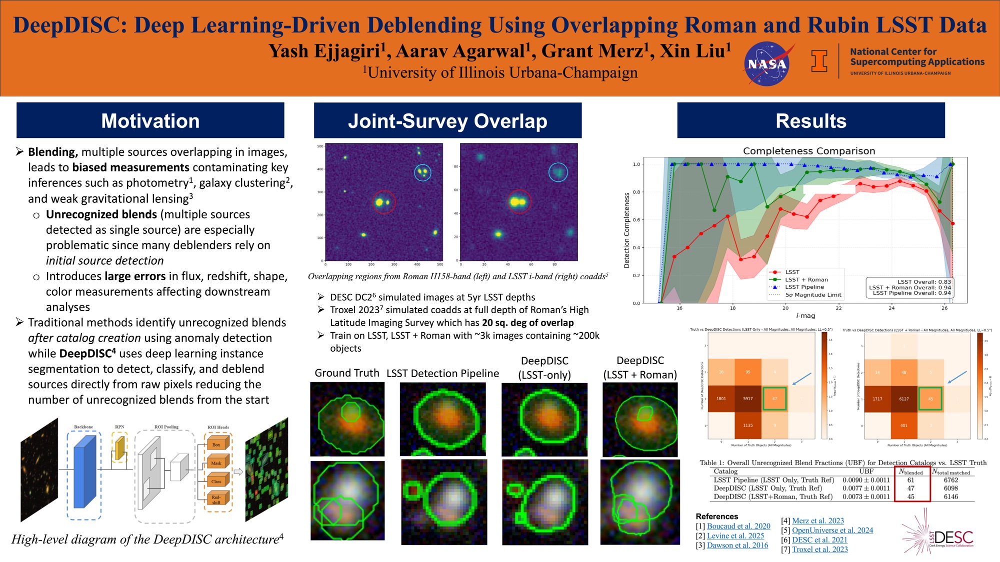

**DeepDISC: Deep Learning-Driven Deblending Using Overlapping Roman and Rubin LSST Data**

> **Abstract:** DeepDISC, our deep learning object detector/deblender/classifier, addresses a critical challenge in large-scale cosmic surveys: the systematic effects of source blending and classification. DeepDISC offers a versatile range of applications, but this study focuses on unrecognized blends, a major source of systematic error present in ground-based surveys such as the Legacy Survey of Space and Time (LSST). With the Nancy Grace Roman Space Telescope's unprecedented capability to survey the sky 1000 times faster than Hubble, while maintaining similar sensitivity and resolution, it presents a unique opportunity to enhance our understanding of galaxy structures and distributions. By leveraging Roman's higher resolution space-based imaging in combination with Rubin Observatory data, we aim to significantly improve the recognition of blended sources compared to traditional detection algorithms. Our model will be trained on simulated Rubin images and input catalogs as a baseline, with the addition of Roman imaging data during training and testing phases. This approach will allow us to quantify the impact of Roman's higher resolution on blend recognition, source classification accuracy, and overall catalog completeness and purity. By comparing DeepDISC's performance against truth catalogs and science pipeline results from both Roman and LSST, we will demonstrate how this synergy between space-based and ground-based observations can optimize scientific output and reduce systematic uncertainties that affect weak lensing measurements. Preliminary tests show a 10% improvement in detection completeness-achieved exclusively through joint Roman-LSST training-leading to a better mapping of the universe that will be crucial for downstream cosmological analyses.

**Recorded Talk**



The Space Telescope Science Institute (STScI) held the symposium [Cosmic Cartography with Roman: Advances in Galaxy Structures, Distributions, Dark Matter, and Dark Energy](https://www.stsci.edu/contents/events/stsci/2025/july/cosmic-cartography-with-roman-advances-in-galaxy-structures-distributions-dark-matter-dark-energy) on July 14–18, 2025. It was hosted in-person at STScI in Baltimore, MD, with virtual attendance and free streaming available. The symposium focused on the intersection of dark energy and dark matter with galaxy formation and evolution.

At the symposium, I presented my work with Prof. Xin Liu and Dr. Grant Merz at UIUC.
